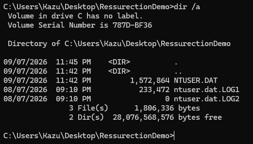
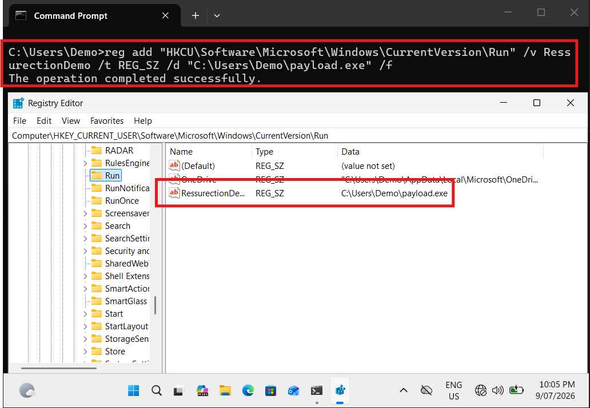
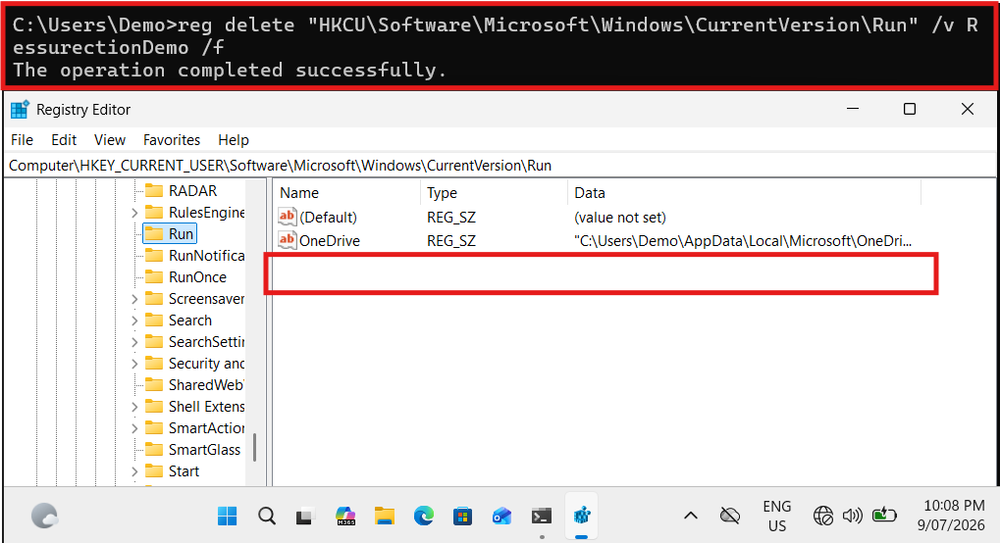
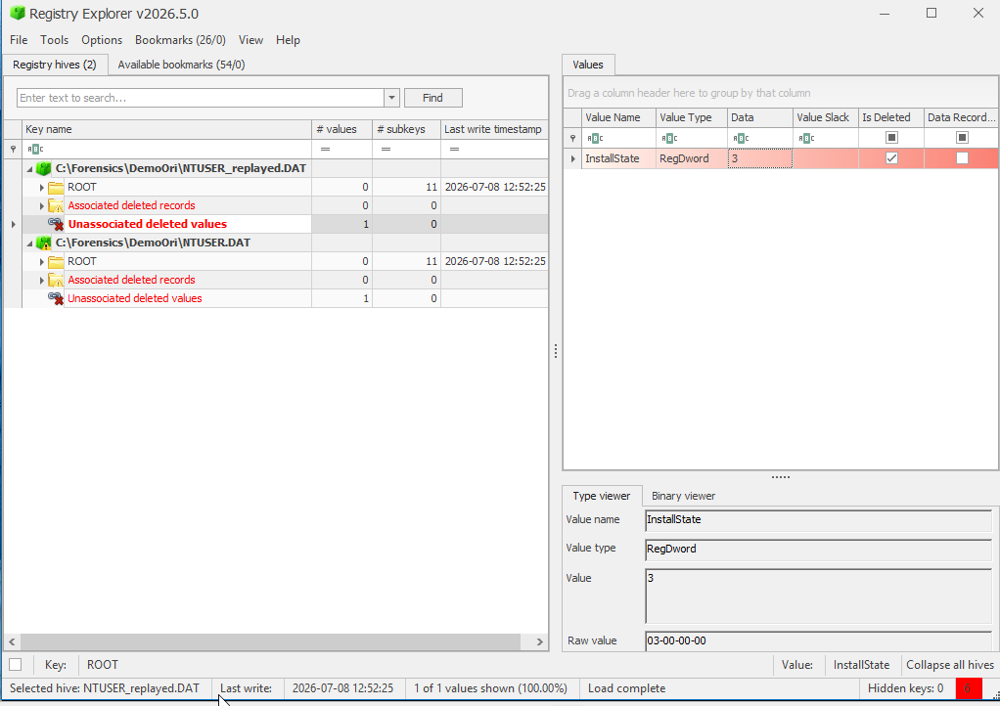
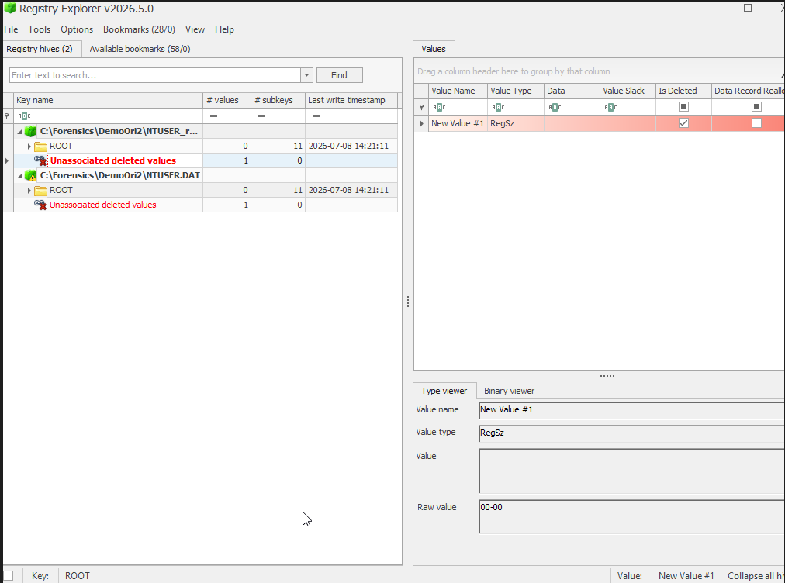
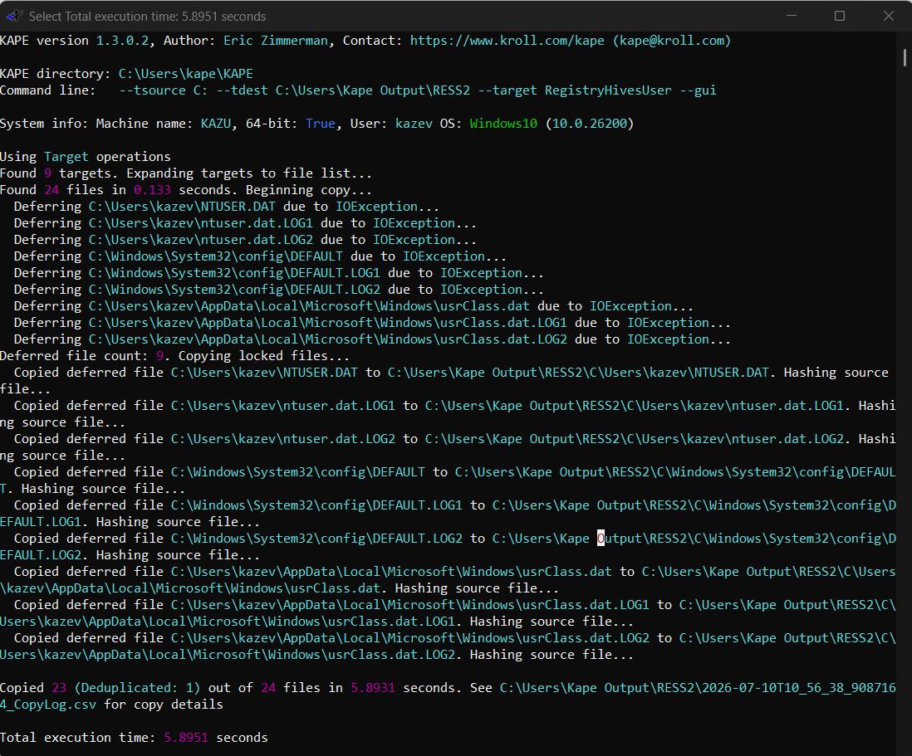
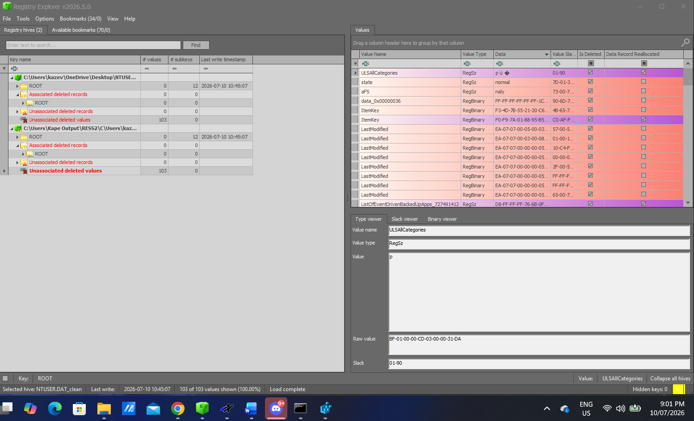
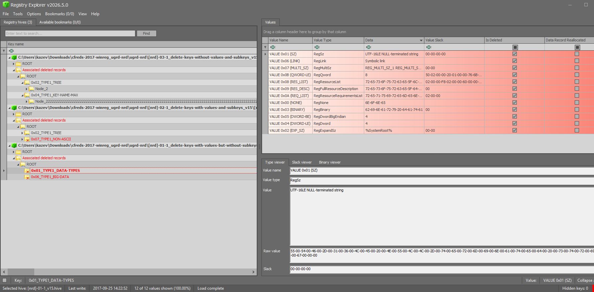
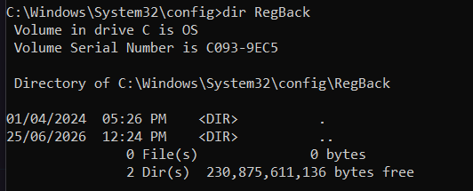

# How to Resurrect the Dead: A Windows Registry Recovery Guide

## Abstract

_The Windows registry records system configuration, installed software, user activity, and program persistence, which makes it one of the richest sources of evidence on a compromised endpoint. Attackers frequently delete registry entries to hide their activity. This article demonstrates why that deletion rarely destroys the underlying data. When a registry element is deleted, Windows marks its storage cells as unallocated rather than wiping them, and it journals registry writes to transaction log files before committing them to disk; both behaviours leave recoverable traces (Via, 2019; Thomassen, 2008). This article reviews four sources of historical registry data and assesses which remain viable on Windows 11. It then reports a recovery exercise using KAPE, and Eric Zimmerman's Registry Explorer, and draws a distinction that most introductory material omits: the difference between recovering deleted data and recovering it with its original location intact. Recovery of deleted keys with their full path was validated against a NIST reference dataset with documented ground truth. The exercise also found that, on a live modern Windows 11 system, the recovery window for a single deleted value can close before acquisition completes, an honest limitation reported here._

_**Keywords:** Windows registry, digital forensics, Associated Deleted Records, Unassociated Deleted Records, transaction logs, anti-forensics, incident response_

## 1. Introduction

Deleting a registry key analogically removes the headstone, not the body. The deleted entry disappears from Windows Regedit, the analyst's live view comes back clean, and to the untrained eye the evidence is seemingly gone. However, the data, in most cases, is still in the ground.

This matters because the registry is where attackers leave some of their most incriminating traces. Persistence mechanisms, malware configuration, and records of execution all pass through it. Threat actors respond by cleaning up: Via (2019) observed that advanced persistent threat actors frequently "utilize anti-forensic techniques to hide their tracks" from incident responders, and deleting registry artifacts is one of the cheapest such techniques available to them. A responder who only inspects the live registry will conclude there is nothing to find.

The problem this article addresses is therefore twofold. First, defenders new to Windows forensics often do not understand *why* deleted registry data survives, or under what conditions it can be recovered. Second, there are premises which suggest that "recovering a deleted key" as a single act, when in fact recovering the data and recovering its original location are two different achievements with very different evidential value.

This article makes three contributions:

1. A beginner-friendly, analogical explanation of why deleted registry data persists, and what "slack" and "unallocated space" actually mean.
2. A recovery exercise using free tools, reporting both a successful located recovery (validated against ground truth) and an honest account of where the author's live recovery failed.
3. An updated assessment of the registry recovery sources documented in the 2019 FireEye research, identifying which remain viable on modern Windows and which are now historical.

Section 2 provides the background and literature necessary to understand registry deletion. Section 3 states the threat model. Section 4 reviews the four recovery sources. Section 5 describes the methodology of the recovery exercise. Section 6 reports the results. Section 7 discusses their meaning and limitations. Sections 8 and 9 give recommendations and conclusions.

## 2. Background

### 2.1 Analogy: The registry as the building manager's logbook

The registry is the central configuration database of Windows. A useful way to picture it is as a building manager's logbook: every tenant (program), every key handed out (setting), and every scheduled maintenance job (autorun, service, scheduled task) gets written down. In this sense, the majority of programs running on Windows, although not entirely all of them, are highly dependent on the registry (Davis, 2026). The operating system consults it constantly, and so do forensic analysts, because it records what software was installed, what programs ran, what devices were connected, and what users did.

On disk, the logbook is split into a small set of binary files called hives. According to Davis (2026), the system hives (DEFAULT, SYSTEM, SOFTWARE, SAM, SECURITY) live in `C:\Windows\System32\Config`, and each user has personal hives (NTUSER.DAT, UsrClass.dat) in their profile. In addition, the hive also hosts Amcache, which is an evidence of execution artifact. 

Internally, a hive behaves like a miniature filesystem. It consists of a base block (a file header) followed by hive bins, and each bin contains cells, the units that actually store keys, values, and data (Suhanov, n.d.-a; Via, 2019). Those cells are the graves this article is about.

### 2.2 Memory versus disk: the lazy scribe analogy

An important detail that most beginner guides skip: Regedit does not show the hive files. It shows the live registry held in memory. The on-disk hive lags behind, because Windows does not write every change to the hive immediately. Davis (2026) complements this fact by describing the hardware hive as 'volatile' as it is built and loaded from the Boot Configuration Data (BCD), existing only in memory.

Instead, Windows uses a journaling scheme. Each hive is accompanied by transaction log files with the same name and a .LOG1 or .LOG2 extension. These LOG files are considered critical since there are many flights of registry data, values, and keys during system operation, which are not yet committed to the hive (Davis, 2026). As Suhanov's format specification describes it, before writing modified (dirty) data to a primary file, a hive writer stores that data in a transaction log file first, so that if a crash interrupts the write, the log contains enough data to bring the primary file back to a consistent state (Suhanov, n.d.-a). Think of a waiter taking orders: the change is jotted on the notepad (the log file) first, and entered into the till (the hive) later. A hive whose pending changes have not yet been written back is called a dirty hive.

The forensic value comes from a second property of the notepad: it is not erased after use. Since Windows 8.1, the log files operate as a ring buffer, meaning new entries are appended until the file fills, and only then does new data begin overwriting the oldest entries (Via, 2019). Recent registry history therefore accumulates in the logs, ordered by sequence numbers, until system activity eventually cycles it out. On real systems this window ranges from days to a few weeks, and registry-heavy events such as Windows Update shorten it considerably (Via, 2019).

### 2.3 What deletion actually does

When a key or value is deleted, Windows does not shred it. The cells holding it are marked as unallocated, meaning available for reuse (Via, 2019; Suhanov, 2018). The analogy: someone tears the entry out of the book's table of contents but leaves the chapter printed inside. Until a new chapter is printed over those pages, the old text remains physically present, and a reader willing to flip through the "blank" pages can still find it. Thomassen's (2008) foundational study confirmed this experimentally, showing that "previously deleted or updated keys and their values indeed remain in the unallocated space until they become overwritten."

Forensic tools do exactly that flipping. They scan a hive for unallocated cells and attempt to interpret the bytes as a key or a value; this is feasible because a key cell begins with the signature `nk` and a value cell begins with `vk`, so a scanner can recognise plausible structures in otherwise free space (Suhanov, 2018). When Via's (2019) team surveyed public methods, they found the common algorithm was to search all unallocated cells for deleted key cells, follow their references to deleted values, then sweep the remaining unallocated cells for orphaned value cells.

> **What is "slack"?**
> Storage is handed out in fixed-size chunks, but the data placed inside rarely fills the chunk exactly. The leftover, reserved-but-unused space is called *slack*. Like a shoebox that still has empty space around a smaller pair of shoes, slack is not scrubbed when reused, so it often still contains fragments of whatever was there before. In a hive this appears in two forms. *Unallocated cells* are fully freed cells holding deleted data (the shallow graves of this article). *Value slack* is the unused tail of a cell that is currently in use by a live value; because that tail is not wiped, it can still hold remnants of a previous, now-deleted value. Via's (2019) team specifically noted that existing tools could recover deleted elements "from slack space of allocated cells that had not yet been overwritten", that is, from the occupied graves, not just the empty ones.

Two consequences follow. First, recovery is a race against reuse: the busier the hive, the sooner old cells are overwritten, and Thomassen (2008) likewise observed that recovered data "was frequently overwritten". This race has a hard deadline, because Windows periodically reorganises (defragments) a hive, compacting allocated data and discarding free space; per Suhanov's specification this reorganization happens roughly once a week when the hive is not locked (Suhanov, n.d.-a). Once reorganization runs, previously recoverable slack may be gone.

Second, the slack survives best in the original on-disk hive, so acquisition method matters. Exporting a hive with `reg save` or `reg export` produces a re-serialised copy of the live registry that does not reliably preserve all recoverable slack. Testing by Suhanov (2020) found that a default export preserves most deleted data but not all: data beyond the last hive bin is not written to the exported file, so a small fraction of recoverable deleted keys and values (approximately 0.6% in his tests) is lost, while remaining present in the original hive. The safest practice, therefore, is raw acquisition of the hive file rather than an exported copy; this point returns in Section 5.

### 2.4 Analogy of Associated versus unassociated recovery: does resurrection preserve the crime scene?

Not all resurrections are equal. When a tool such as Registry Explorer carves deleted records from a hive, it sorts them into two categories, and the difference matters enormously for an investigation.

According to Davis (2026), the underlying data of deleted registry key or value sits in allocated cell until Windows reuses that particular space for something new. The cell normally carries pointers linking it to related cells, including its parent key. As Carvey (2008) noted when describing the first tooling for this task, recovered key cells "have pointers to their parent keys (so that investigator can reassemble the full path of the key), timestamps... as well as pointers to their values." Those pointers tell the story *where* the deleted item lived. When an item is deleted, both its data and these pointers become candidates for reuse, but they are not always overwritten at the same time.

**Associated deleted records** are those where the parent pointer survived. The tool can walk the pointer back and reconstruct the full path, so it can tell where the deleted value sat under, for example, `Software\Microsoft\Windows\CurrentVersion\Run`. In this way, both the body and its exact grave could be recovered because the full metadata exists (Davis, 2026).

**Unassociated deleted values** are those where the data survived but the parent pointer did not. The value was recovered, but not where it lived. The body is on the table, but its grave is unmarked. Carvey (2008) made exactly this point about evidential weight: registry values recovered without a parent key or timestamp are "about as useful as finding some text in the pagefile or file slack."

For a forensic investigation this distinction is the difference between evidence and trivia. A recovered value named `Updater` pointing to `C:\Users\Public\x.exe` is only incriminating if an investigator can show it was a Run key, that is, a persistence mechanism. As an unassociated orphan it proves only that the string once existed in the hive; whereas, as an associated record under a Run key, it proves an attacker installed persistence and then tried to remove it. To carry the article's metaphor: resurrecting a body is not enough. To reopen the case one must prove *this* body was buried *here*. Location is what turns a recovered value into a persistence artifact.

Several factors decide which category a deletion falls into. Recent deletions are more likely to remain associated, because their pointers have not yet been overwritten. Older deletions on busy hives degrade toward unassociated orphans as surrounding cells are reused. How the deletion was performed also matters: deletions made through the Windows registry API tend to leave cleaner, more recoverable structures than direct manipulation of the hive file, a distinction the NIST reference dataset deliberately tests through separate deletion methods (National Institute of Standards and Technology, 2018). Where the parent pointer is gone, location can sometimes still be reconstructed from other sources, such as: the transaction logs which record the parent key path of each operation, the parent key's own last-write timestamp which can corroborate when a change occurred there, and a pre-deletion backup or shadow copy which contains the value still in place.

## 3. Threat Model

### 3.1 Why attackers write to the registry

Before an attacker deletes anything from the registry, they put something there. The most common motive is persistence: surviving a reboot. Run keys, Windows services, and scheduled tasks all live in the registry, and all guarantee the attacker's code executes again after restart. MITRE ATT&CK catalogues these under T1547.001 (Registry Run Keys / Startup Folder) among others. The registry also serves as a hiding place. Fileless malware stores its configuration or even entire payloads inside registry values, avoiding the file system where antivirus looks hardest, a family of behaviours tracked under T1112 (Modify Registry). Finally, the registry holds treasure in its own right: the SAM and SECURITY hives contain local credential material that attackers extract for lateral movement.

### 3.2 Why attackers delete

Every one of those writes is a confession waiting to be read. Once the objective is achieved, the mission shifts to leaving quietly. Removing the Run key, deleting the service entry, and clearing the traces of execution all fall under ATT&CK T1070 (Indicator Removal). The goal is simple: when the incident responder arrives and opens the logbook, the pages should look untouched, and the timeline of the intrusion should have holes exactly where the attacker stood.

### 3.3 Why defenders resurrect

A recovered registry artifact answers the questions that drive every investigation: what ran, when, and under which account. A resurrected Run key value proves persistence existed even after the attacker cleaned it. Its timestamps anchor the intrusion timeline. Its payload path tells the analyst where to look next on the file system.

Just as importantly, a recovered artifact is rarely conclusive alone. It is just one witness, and witnesses must be corroborated to see if they tell the same story. A resurrected registry entry gains its evidential weight when event logs, file system metadata, and network records tell the same story, which is the same multi-source corroboration discipline that governs digital forensics generally. Recovery, in other words, is not the end of the investigation. It is what reopens it.

## 4. Recovery Sources: The Analogy of Four Graves

If deleted registry data is a body, then Windows maintains four kinds of grave, and each demands a different kind of digging. The unallocated cells inside the hive are shallow graves: easy to reach, but easily disturbed. The transaction logs are the coroner's notes: a reliable record of recent deaths. The transactional registry is a niche archive: rarely consulted, occasionally priceless, and now largely sealed. The backups are body doubles: full copies frozen in time, if anyone remembered to make them. This section reviews each, including whether it still works on Windows 10 and 11.

### 4.1 Unallocated cells in the hive (the shallow graves)

**Mechanism.** As described in Section 2.3, deletion marks cells as unallocated without wiping them, and tools carve them back by scanning for `nk` and `vk` structures (Suhanov, 2018). Whether a recovery is associated or unassociated depends on whether the parent pointer also survived (Section 2.4).

**Tooling.** Eric Zimmerman's Registry Explorer performs this scan automatically and displays recovered entries in red, separating them into associated and unassociated nodes. On the command line, Suhanov's yarp offers `yarp-print --deleted`, which Carvey (2019) documents as an accurate approach for parsing deleted keys and values. The Python library regipy provides the same capability programmatically (Fortuna, 2021).

**A Caveat.** Not everything recovered is trustworthy. Cells are recycled constantly, and when a cell has been reused, tools can attach orphaned data to the wrong parent. Via (2019) found that in such cases existing tools "will make incorrect deleted value associations and output invalid data." Recovered entries are leads to corroborate, never conclusions.

**Viability on Windows 10/11.** Fully alive on every Windows version, and the fastest technique to apply.

### 4.2 Registry transaction logs (the coroner's notes)

*Figure 1. Transactional logs (.LOG1 and .LOG2) for NTUSER.DAT viewed from powershell*

**Mechanism.** Every registry write is journaled to the hive's .LOG1/.LOG2 files before being committed (Section 2.2). Because the logs are a ring buffer, they retain a rolling window of recent registry history, ordered by sequence number.

**What it recovers.** Recent creations, modifications, and deletions, including the state of values before they changed. This produces the most striking finding of the FireEye research: an attacker who overwrites a value before deleting it defeats slack-space recovery, since the original cell content is gone from the hive, yet the original write may still sit in the log. In Via's (2019) experiment, existing tools could not recover the overwritten value, "but the data was still present in the transaction log." Crucially for Section 2.4, the log records the parent key path of each operation, so log replay can restore not only just the value, but also where it lived.

**Recovery window.** Days to weeks, depending on system activity, with registry-heavy events such as Windows Update aggressively cycling the buffer (Via, 2019).

**Tooling.** Registry Explorer detects a dirty hive on load and offers to replay the logs. Eric Zimmerman's rla.exe and Suhanov's yarp perform the merge standalone. A well-known pitfall: RegRipper does not process transaction logs automatically, so hives must be merged first (Carvey, 2019).

**Viability on Windows 10/11.** Fully alive, and today the primary recovery technique. Collection playbooks must acquire the .LOG1/.LOG2 files alongside every hive; a hive without its logs is a book missing its most recent chapter.

### 4.3 The transactional registry (the niche archive)

**Mechanism.** Separate from the crash-resilience logs above, Windows Vista introduced the transactional registry, a feature that lets a program accumulate multiple modifications within a transaction that can be committed or rolled back as a single unit, like a database transaction (Suhanov, n.d.-a). These transactions are journaled in their own .TxR log files.

**What it recovered.** On Windows Vista through 8.1, the Task Scheduler used registry transactions when creating and deleting scheduled tasks. Parsing the .TxR logs could therefore reveal attacker-created scheduled tasks that had been deleted and were recoverable nowhere else (Via, 2019).

**Viability on Windows 10/11.** Dead. Via (2019) confirmed that the Task Scheduler on Windows 10 no longer exhibits the transactional behaviour, so the technique is presented here as forensic history. It remains instructive because the pattern, a secondary journal capturing what the primary record lost, is exactly what keeps the other graves productive.

### 4.4 Backups: RegBack and System Restore (the body doubles)

**Mechanism.** Two Windows features historically kept full copies of the hives. The RegIdleBackup is a scheduled task that run copied the system hives to `C:\Windows\System32\Config\RegBack` every ten days (Davis, 2026). Separately, System Restore points, created automatically around software installs and uninstalls, capture complete hive sets inside Volume Shadow Copies (Via, 2019).

**What it recovers.** Entire historical hives. Because a backup contains the target key with the value still in place, it is the one source that recovers a deleted value with its full location every time, no carving required.

**Viability on Windows 10/11.** Degraded to configuration-dependent. Since Windows 10 version 1803, RegIdleBackup still runs but writes nothing, leaving zero-byte files, a deliberate Microsoft change to save disk space (Microsoft, 2019). On a default modern installation, this grave is empty. System Restore is frequently disabled, and ransomware operators routinely destroy shadow copies before detonation precisely to burn these body doubles. The backup can be revived by setting the `EnablePeriodicBackup` value under `HKLM\System\CurrentControlSet\Control\Session Manager\Configuration Manager`.

### 4.5 Summary of viability

| Recovery source | Metaphor | Windows 7/8.1 | Windows 10/11 (default) |
|---|---|---|---|
| Unallocated hive cells | Shallow graves | Alive | Alive |
| Transaction logs (.LOG1/.LOG2) | Coroner's notes | Alive | Alive, primary technique |
| Transactional registry (.TxR) | Niche archive | Alive (Vista to 8.1) | Dead |
| RegBack backups | Body doubles | Alive | Empty by default |
| System Restore / VSS hives | Body doubles | Configuration-dependent | Configuration-dependent |

## 5. Methodology

The recovery exercise had two aims: to demonstrate the concept of an attacker planting and deleting a persistence artifact, and to demonstrate recovery of deleted registry records, including the distinction between recovering data and recovering location.

**Concept lab (Sections 6.1 to 6.2).** A disposable local user account was created on a Windows 11 virtual machine. Using this account, a string value named `ResurrectionDemo` was created under `HKEY_CURRENT_USER\Software\Microsoft\Windows\CurrentVersion\Run`, pointing to a non-existent path (`C:\Users\demo\payload.exe`). This mimics the most common attacker persistence technique (ATT&CK T1547.001) while ensuring nothing executed. The value was then deleted through Regedit to simulate an attacker removing their persistence.

**Acquisition.** Hives were collected with KAPE (Kroll Artifact Parser and Extractor) using the `RegistryHivesUser` target, which copies each user hive together with its .LOG1/.LOG2 transaction logs. Raw acquisition was chosen over `reg save`/`reg export` because, as established in Section 2.3, exported copies do not reliably preserve all recoverable slack (Suhanov, 2020).

**Analysis.** Collected hives were loaded into Eric Zimmerman's Registry Explorer with deleted-record recovery enabled. Where a hive was dirty, its transaction logs were replayed against a working copy while the originals were preserved and hashed.

**Validation dataset.** To demonstrate located (associated) recovery against known ground truth, the exercise used the NIST CFReDS reference dataset cfreds-2017-winreg, which publishes hives containing deliberately deleted keys at documented locations, together with a technical report specifying exactly what was deleted and where (National Institute of Standards and Technology, 2018).

This is a teaching reconstruction, not an evidence-handling procedure. In a real investigation the disk would be imaged and all analysis performed on verified, hashed copies.

## 6. Results

The results are presented as four acts: burying a body, watching it disappear, resurrecting it, and checking the one grave that proved empty.

### 6.1 Act 1: Bury the body

The value `ResurrectionDemo` was created in the Run key of the disposable account's NTUSER.DAT hive, pointing to a non-existent payload path.

*Figure 2. The planted `ResurrectionDemo` value in the Run key, viewed in Regedit.*

### 6.2 Act 2: The murder

The value was deleted through Regedit. To a responder inspecting the live registry afterwards, the Run key appeared clean and the persistence appeared never to have existed.

*Figure 3. The same Run key after deletion. The persistence value is absent from the live view.*

### 6.3 Act 3a: Unassociated recovery, the body without the grave

After repeating Act 1 and Act 2, the author reconstructed deleted keys recovery using KAPE and Registry Explorer in repetitious attempts, and yielded different results as shown below:

#### 6.3.3a.1 : Deleted key was captured too late

*Figure 4. Recovered deleted values from a live NTUSER.DAT hive collected with KAPE. The hive got a dirty capture (the replay ran, deleted records were recovered), but the deletion captured in the log was an unrelated value (`InstallState`) rather than the planted `ResurrectionDemo`, indicating the planted deletion had already been flushed and its cell reused due to registry-heavy activity (Via, 2019).*

#### 6.3.3a.2 : Deleted keys was captured too fast

*Figure 5. Recovered deleted values from a live NTUSER.DAT hive collected with KAPE. The recovered value is `New Value #1`, RegSz, with **empty data**. The value name is what regedit assigns a string value the instant a key was created, before it got rename into 'ResurrectionDemo' (Honeycutt, 2005). So what got captured and recovered is the value at a moment when it existed but had not been named `ResurrectionDemo` or given its data yet.*

#### 6.3.3a.3 : Reboot after deleted the `ResurrectionDemo` key and captured using kape.exe (CLI) 

*Figure 6. Recovered deleted values from a live NTUSER.DAT hive collected with KAPE CLI. The summary confirms successful carving: **Copied 23 (Deduplicated: 1) out of 24 files in 5.4268 seconds.** The NTUSER.DAT, both its LOG files, plus DEFAULT, usrClass.dat, and their logs were collected.*

Loading the author's own collected NTUSER.DAT into Registry Explorer, with deleted-record recovery enabled, returned 103 recovered deleted values. All appeared under the Unassociated deleted values node: the data survived, but the parent pointers had been overwritten by prolonged normal system use, so the tool recovered what these values were but not where they had lived.

*Figure 7. Recovered deleted values from a live NTUSER.DAT hive collected with KAPE. Each red row is a deleted value carved from unallocated space, but all are unassociated: orphaned data recovered without original registry path, and the 'ResurrectionDemo' key was not captured in Associated Deleted Records. However, Registry Explorer displayed recovered deleted values `ULSAllCategories`, `state`, `LastModified`, `ItemKey`, each flagged as deleted. The selected one (`ULSAllCategories`, RegSz) even shows its recovered data and raw value in the Type viewer at bottom right.*
### 6.4 Act 3b: Associated recovery, the body in its grave, validated

The recovery was repeated against a NIST reference hive. The hive `[nrd]-01-1_delete-keys-with-values-but-without-subkeys` was loaded; NIST's technical report documents that two keys were deleted from it via the Windows registry API: `ROOT\0x01_TYPE1_DATA-TYPES` and `ROOT\0x06_TYPE1_BIG-DATA`. Registry Explorer recovered both and placed them under the Associated deleted records node with their full ROOT path reconstructed. The recovered keys matched NIST's documented ground truth.

*Figure 8. Registry Explorer recovering deleted keys from the NIST CFReDS cfreds-2017-winreg reference hive. The keys `0x01_TYPE1_DATA-TYPES` and `0x06_TYPE1_BIG-DATA` appear as associated deleted records with their full ROOT path intact, matching NIST's documented ground-truth deletions.*

### 6.5 Act 4: The empty grave

Inspecting `C:\Windows\System32\Config\RegBack` on the Windows 11 host returned zero files and zero bytes.

*Figure 9. The RegBack directory on Windows 11, showing 0 files and 0 bytes.*

## 7. Discussion

### 7.1 Recovering data versus recovering the crime scene

Read together, Figures 4, 5, and 8 make the central technical point of this article visible. All those recoveries resurrected deleted data, yet only figure 8 recovered the crime scene: the location that turns a recovered value into evidence of where an attacker acted. This is the practical consequence of the associated/unassociated distinction set out in Section 2.4, and it aligns with Carvey's (2008) observation that a recovered value without a parent key is of little evidential use on its own. For an incident responder, the lesson is that a successful carve is not automatically a useful finding; the value's original location must be established, whether directly through an associated record, or indirectly through transaction logs, parent-key timestamps, or a backup.

### 7.2 The recovery window on Windows 11: an honest negative result

A finding emerged during this exercise that is worth reporting because it contradicts how introductory tutorials usually present the technique. Repeated attempts to recover the specific `ResurrectionDemo` value from live systems, as an associated record with its Run-key path intact, were unsuccessful. On modern Windows 11 the registry is flushed to disk aggressively and freed cells are reused quickly, especially while Windows Update is active, which was observed to collapse the recovery window and reassign the freed cell before acquisition completed. In several captures, the only recoverable deletions were unrelated background operations rather than the planted value, and the author's live hives yielded only unassociated recoveries. This is consistent both with Via's (2019) finding that registry-heavy activity sharply shortens the transaction-log recovery window, and with the reorganization behaviour documented by Suhanov (n.d.-a), whereby hives are periodically compacted and free space discarded. For this reason, located recovery was demonstrated against the NIST reference dataset, where the deletions are documented and the ground truth is known, rather than against a self-planted value. The lessons learned from this negative result characterises a real operational constraint: on a live, busy system, the time window in which a specific deletion remains recoverable with its location could be either extremely short, or must be done within a certain running environment.

### 7.3 Comparison with prior work

The recovery mechanism demonstrated here rests on findings established over more than a decade. Thomassen (2008) first showed experimentally that deleted keys and values persist in unallocated space until overwritten. Morgan (2008) and Suhanov (2018) formalised the carving algorithms and documented how different tools vary in correctness. Via (2019) extended recovery to the transaction logs and demonstrated recovery of overwritten values that slack-space carving alone cannot reach. This article does not add to that primary research; its contribution is to make the concepts accessible to newcomers, to demonstrate them with current free tooling such as KAPE and Registry Explorer, to validate a located recovery against NIST ground truth, and to report honestly the conditions under which live recovery fails.

### 7.4 Limitations

This exercise has several limitations that readers should keep in mind:

- **Single artifact type on a virtual machine.** 

  The author tested one specific type of registry entry, not the full range an attacker might use (services, scheduled tasks, and so on). And it was conducted on a live practice machine for convenience, whereas a real investigation would first make a forensic copy of the disk and work only on that copy. This is because the article is intended as a teaching setup, not a courtroom-grade procedure.
- **Recovery is timing-dependent and never guaranteed.** 

  By theory, a deleted entry survives only until Windows reuses that space for something else. This means that on a busy system that can happen in seconds. Thus, the premise of "you can always recover it" is false; sometimes the recovery attempts are simply too late, and there is no way to guarantee success in advance as the author experienced in this exercise.
- **The overwritten-value recovery was not reproduced.** 

  One powerful technique from the source research (pulling back a value even after it was written over, by reading the change journal) is described here on the authority of Via's (2019) research. Since the author of this article did not perform it personally, it is presented as a citation.
- **The transactional registry findings are historical.** 

  Considering that one of the four recovery sources mentioned in Section 4, which is .TxR transactional-registry technique, applies only to Windows Vista through 8.1 and no longer works on Windows 10 or 11, it is then effectively obsolete on modern Windows. It is included for completeness and because older systems still exist out there; however, it is not expected to work on a current or modern machine.
- **Located recovery used sampled NIST test keys, not a live persistence value.** 

  Through presentation of secondary data, the author proved that recovery can preserve an item's original location (the associated deleted records), but it was done using NIST's ready-made test data (where the "right answer" is documented) rather than using own planted value (ResurrectionDemo Value). This is because live modern Windows 11 kept flushing the planted value before the author could capture it. The capability is real; the specific example is a reference dataset.
- **Recovered data always needs expert interpretation and corroboration.** 

  As quoted from Via (2019), deleted entries can be misassociated or corrupted when cells are reused. This means that carving tools sometimes attach recovered data to the wrong place or return garbage. A recovered binary or entry only points where to look next; it does not settle the case on its own. It is imperative that investigators must corroborate it against other evidences such as event logs, file timestamps, and network records before drawing conclusions.

## 8. Recommendations for Defenders

- Collect hives together with their .LOG1 and .LOG2 files in every triage playbook. A hive without its logs is missing its most recent history.
- Acquire hive files raw (KAPE, FTK Imager). Do not rely on `reg export` output for forensic work, as it does not preserve all recoverable slack (Suhanov, 2020).
- Acquire early. The recovery window on a live system is narrow and shrinks with system activity; the sooner a hive is collected after a suspected deletion, the more likely the recovery preserves location.
- Re-enable periodic registry backups via the `EnablePeriodicBackup` value on endpoints you defend, and preserve Volume Shadow Copies before anything else touches the disk.
- Treat a dirty hive as normal, not suspicious, and treat every recovered artifact as a lead requiring corroboration, not a conclusion.

## 9. Conclusion

The premise of registry anti-forensics is that deletion equals destruction. This article showed the premise is false. Windows marks deleted cells as unallocated rather than wiping them, journals every write to a transaction log before committing it, and, where properly configured, keeps whole copies of its hives. Each behaviour exists for reliability, not forensics, yet each leaves a trail that outlives the attacker's cleanup.

But resurrection is not one act, it is two. Recovering the data proves something existed; recovering its location proves where it existed, and location is what turns a recovered value into evidence. The exercise showed both phases of this: an orphaned recovery that returned data without its grave, and a validated recovery that returned deleted keys in their documented place. It also showed, honestly, that on a live modern Windows 11 system, the located recovery is far from guaranteed because the registry flushes and reuses freed space faster than most guides admit.

For the defender, the lesson is one of habit rather than heroics. Acquire hives with their logs, acquire early, work on hashed copies, know which sources are alive on modern Windows and which graves are empty by design, and corroborate everything recovered. The registry keeps its own receipts. The author concludes that although deletion by threat actors removes the headstone, but for an analyst who knows where to dig, the body is usually still in the ground.

## References

- Carvey, H. (2008). *Deleted Keys in the Registry*. Windows Incident Response. http://windowsir.blogspot.com/2008/07/deleted-keys-in-registry.html
- Carvey, H. (2019). *Registry Transaction Logs, pt II*. Windows Incident Response. http://windowsir.blogspot.com/2019/04/registry-transaction-logs-pt-ii.html
- Fortuna, A. (2021). *Windows registry Transaction Logs in forensic analysis*. https://andreafortuna.org/2021/02/06/windows-registry-transaction-logs-in-forensic-analysis/
- Honeycutt, J. (2005). *Microsoft Windows Registry Guide_ (2nd ed.). Microsoft Press. (See "Editing the Registry": Regedit names new values `New Value #N`.)*. https://dokumen.pub/microsoft-windows-registry-guide-2-ed.html
- Microsoft. (2019). *The system registry is no longer backed up to the RegBack folder starting in Windows 10 version 1803*. https://learn.microsoft.com/en-us/troubleshoot/windows-client/installing-updates-features-roles/system-registry-no-backed-up-regback-folder
- MITRE ATT&CK. *T1547.001: Boot or Logon Autostart Execution: Registry Run Keys / Startup Folder*. https://attack.mitre.org/techniques/T1547/001/
- MITRE ATT&CK. *T1112: Modify Registry*. https://attack.mitre.org/techniques/T1112/
- MITRE ATT&CK. *T1070: Indicator Removal*. https://attack.mitre.org/techniques/T1070/
- Morgan, T. D. (2008). *Recovering deleted data from the Windows registry*. Digital Investigation, 5, S33-S41. https://www.sciencedirect.com/science/article/pii/S1742287608000303
- National Institute of Standards and Technology. (2018). *CFReDS: A Windows Registry Dataset (cfreds-2017-winreg)*. https://cfreds-archive.nist.gov/winreg/cfreds-2017-winreg/cfreds-2017-winreg.html
- National Institute of Standards and Technology. (2018). *cfreds-2017-winreg Technical Report (v1.10)*. https://cfreds-archive.nist.gov/winreg/cfreds-2017-winreg/cfreds-2017-winreg.pdf
- Rathbun, A. *Registry Explorer / RECmd guide*. AboutDFIR. https://aboutdfir.com/toolsandartifacts/windows/registry-explorer-recmd/
- Suhanov, M. (2018). *Tools that recover deleted registry data don't do the same job*. dfir.ru. https://dfir.ru/2018/11/18/tools-that-recover-deleted-registry-data-dont-do-the-same-job/
- Suhanov, M. (n.d.-a). *Windows registry file format specification*. GitHub. https://github.com/msuhanov/regf/blob/master/Windows%20registry%20file%20format%20specification.md
- Suhanov, M. (n.d.-b). *yarp: yet another registry parser*. GitHub. https://github.com/msuhanov/yarp
- Thomassen, J. (2008). *Forensic Analysis of Unallocated Space in Windows Registry Hive Files* (Master's thesis, University of Liverpool). https://sentinelchicken.com/research/thomassen_registry_unallocated_space/
- Via, D. (2019). *Digging Up the Past: Windows Registry Forensics Revisited*. FireEye Threat Research (republished by Trellix). https://www.trellix.com/en-au/blogs/research/digging-up-the-past-windows-registry-forensics-revisited/
- Zimmerman, E. *Registry Explorer / RECmd / rla*. Eric Zimmerman's Tools. https://ericzimmerman.github.io/
- Kroll. *KAPE (Kroll Artifact Parser and Extractor)*. https://www.kroll.com/en/services/cyber/incident-response-litigation-support/kroll-artifact-parser-extractor-kape
- 13Cubed (Davis, R.). *Investigating Windows Endpoints*. https://www.13cubed.com/

