# Windows Registry PLab: Resurrecting the Dead (Part 1)

## 1. Introduction

### The Problem

When we talk about recovering Windows registry for the purpose of finding forensic artifacts, the setting is usually situated where a threat actor has already broken into a Windows machine. To make sure their code survives a reboot, the attackers add a startup entry to the Windows registry. Later, once their malicious objective is achieved, they perform some anti-forensic techniques to erase their traces. After several minutes, or days, depending how the defender's detection works, the defenders finally realised that something needs to be investigated either because of detection alert, or in a worst case scenario, the attacker has published the victim's stolen assets on dark web. For the later, it means that the published incident, ransom note, or leaked customer data on public *ironically becomes* the alert itself. Though this might sound exaggerated, the gap between break-in and discovery of an attack is not hypothetical as Mandiant's (2026) frontline data put the 2025 global median at 14 days; and that is the _median_, meaning half of the intrusions ran longer than 14 days after the initial breach to be detected. So at this point, when the incident responder arrives and opens the registry, the attacker has done many things: lateral movement, data exfiltration, setting up persistence, with nobody watching. They look at the registry startup list which looks completely normal, nothing suspicious, and no trace.

Except the trace is actually still there. It just cannot be seen from the live registry.

Part 1 of this series attempts to address these questions from a digital forensic standpoint: When something is deleted from the Windows registry, is it actually gone, and if not, can a defender bring it back? More importantly, can a defender bring it back in a way that still proves *where* it was, because a recovered string or value on its own does not prove much at all.

### The background story

The idea for this lab came from research published by FireEye (now Trellix), titled "Digging Up the Past: Windows Registry Forensics Revisited" (Via, 2019). That article documents several places where deleted registry data survives, including the registry's own transaction logs. For me as a beginner in the realm of digital forensic, it is an eye-opener research. However, I think that the research assumes the reader already knows how registry internals work, and it seems like it is written for practitioners rather than newcomers.

Nevertheless, the motivation to restore registry artifacts is definitely not academic. As Via (2019) observed, advanced persistent threat actors frequently "utilize anti-forensic techniques to hide their tracks" from incident responders, and deleting a registry key is one of the cheapest such techniques available to them.

So this lab was built to answer a simpler question in a hands-on way: can a beginner, using only free tools, plant a fake attacker persistence entry, delete it, and then genuinely resurrect it from the hive file?

The short answer is yes, but with conditions that took me a lot of failed attempts to discover. This first part shows the version that works, from start to finish, on Windows 7 Virtual Machine.

### Why Windows 7

There are two reasons Windows 7 is chosen. First, legacy systems are still out there in the field. In fact, I had a chance to work in one of my workplace environment where Windows 7 was used in a production for a while in 2025. So yeah, this is not a museum exercise. Second, and more practically, Windows 7 gave a clean, repeatable result. Modern Windows 11 behaves differently, and that comparison is the subject of Part 2.

### What you will see in Part 1

In a nutshell, here is what I share in Part 1: 

- What the registry actually is, in analogical narration and plain language
- Why deleting something from it does not destroy it
- Why rebooting before parsing Windows 7 image is an important step in this lab
- The critical difference between recovering *data* and recovering *location*
- A follow-along live lab: plant a persistence key, delete it, recover it with its full path intact

---

## 2. Basic Theoretical Backgrounds

### 2.1 What the registry is, in plain language

Think of the Windows registry as a building manager's logbook. Every tenant (program), every key handed out (user's setting), and every scheduled maintenance job (startup entry, service, scheduled task) gets written down in it. Davis (2026) argues that the registry is so important that Windows reads this logbook constantly, and although not every program that runs on Windows has to use the registry, the majority of it, greatly depends on it. 

On disk, the logbook is not one file. In fact, there is no actual file path of registry logbook on disk. Rather, it is split into several binary files called **hives**, in which most of the main chunk of it is located on `%SystemRoot%`. By default, this is usually located at `C:\Windows\System32\config`.

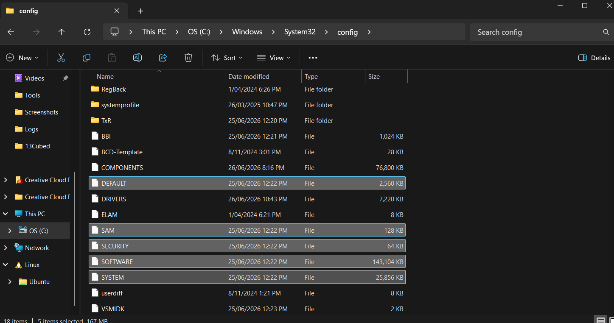
Figure 1: The DEFAULT, SYSTEM, SAM, SOFTWARE, SECURITY hives, viewed from Windows Explorer at `C:\Windows\System32\config`


| Hive                                        | Location                     | What it holds                      |
| ------------------------------------------- | ---------------------------- | ---------------------------------- |
| DEFAULT,<br>SYSTEM, SOFTWARE, SAM, SECURITY | `C:\Windows\System32\Config` | Machine-wide settings, credentials |
| NTUSER.DAT                                  | Each user's profile folder   | That user's personal settings      |
| UsrClass.dat                                | User profile (AppData)       | File associations, shell data      |

On Windows machines, these Windows Registry files can be accessed from Registry Editor.
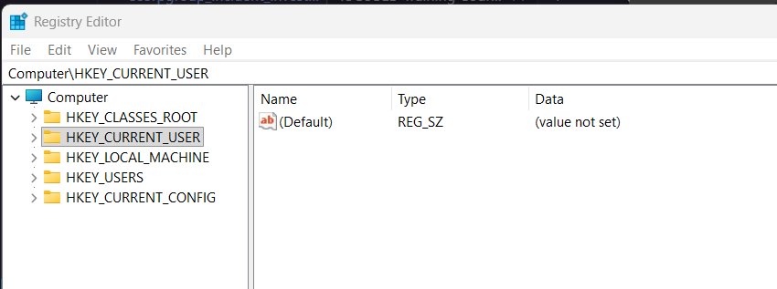

Figure 2: Type "reg" on search and look for "Registry Editor". These are called `Root registry keys`, and everything under this area is called a `subkey`. 


| Registry Keys         | What it stores                                                                                                                                 |
| --------------------- | ---------------------------------------------------------------------------------------------------------------------------------------------- |
| `HKEY_CLASSES_ROOT`   | Association of files extension with specific program to which it can open (for example, .pdf file is opened with Adobe Acrobat)                |
| `HKEY_CURRENT USER`   | Implementation of registry with the current user that you're currently logged in as. It is made up of `NTUSER.DAT` and part of `UsrClass.dat`. |
| `HKEY_LOCAL MACHINE`  | The important hives:`SAM, SECURITY, SOFTWARE, and SYSTEM`.                                                                                     |
| `HKEY_USERS`          | Configuration of all active users on the system, including the `DEFAULT`file.                                                                  |
| `HKEY_CURRENT_CONFIG` | The current hardware profile of the local computer system. It is stored in memory and rendered upon boot.                                      |

Internally, a hive behaves like a miniature filesystem. It begins with a base block (a file header), followed by hive bins, and each bin contains **cells**, which are the units that actually store keys, values, and data (Suhanov, n.d.-a; Via, 2019). Those cells are the focus of this article because they are where deleted data goes to hide. When a key or value is removed, its cell is not wiped, it is only marked as free, so the original bytes sit in place until something reuses that space.

### 2.2 Regedit is lying to you (sort of)

Here is a detail that is important. When you open Regedit, you are **not** looking at the hive files on disk. Davis (2006) exemplifies that "the HARDWARE hive is volatile, built at boot, and exists only in memory". So in Regedit, you are looking at the live registry held in memory.

The on-disk hive lags behind. Microsoft (n.d.) documents that the registry uses a **lazy flush** mechanism, writing modifications to disk at regular, system-specified intervals, and also flushing at system shutdown. Changes are visible to running programs instantly, but they reach the disk later. In other words, Windows does not write every change to the hive immediately.

Before writing dirty data to the primary hive file, the flush process first stores that data in a transaction log file, so that if a crash interrupts the write, the log holds enough information to bring the hive back to a consistent state (Suhanov, n.d.-a). These journal files sit right beside the hive, named `NTUSER.DAT.LOG1` and `NTUSER.DAT.LOG2`.

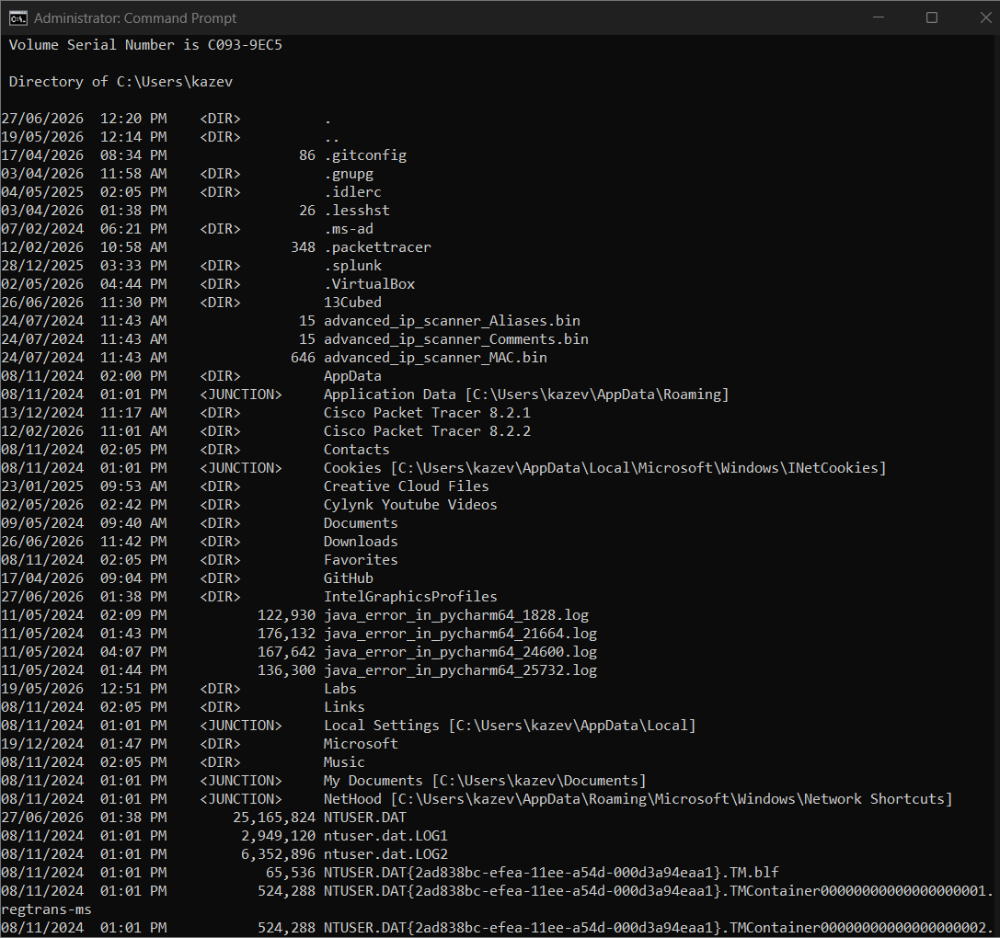

Figure 3: executing the command `dir /a` from `C:\Users\[your username]` on CMD reveals `NTUSER.DAT`, along with its corresponding `ntuser.dat.LOG1` and `ntuser.dat.LOG2`. 


> **Analogy:** picture a waiter taking your order. They write it on a notepad first (the log file), then enter it into the till later (the hive). If the till crashes, the notepad still has your order.

The forensic value comes from a second property of the notepad as it is not erased after use. Since Windows 8.1, the log files operate as a ring buffer, meaning new entries are appended until the file fills, and only then does new data begin overwriting the oldest entries (Via, 2019). Recent registry history therefore accumulates in the logs, ordered by sequence numbers, until system activity eventually cycles it out. On real systems this window ranges from days to a few weeks, and registry-heavy events such as Windows Update shorten it considerably (Via, 2019).

### 2.3 Why you must reboot: an important step in this lab

This section exists because skipping this step is what caused this lab to fail repeatedly before it finally worked. 

#### The core problem

You already know from the previous section that Windows does not write registry changes to disk immediately. It uses a lazy flush (Microsoft, n.d.). Now think about what that means for our experiment.

If you **create** a value and then **delete** it a minute later, both actions happen in memory. Windows has not necessarily written either one to disk yet. So when the flush finally happens, what does it write?

It writes the **end state**. And the end state is "this value does not exist."

The value was born and died entirely in memory. The hive on disk never once contained it. There is no deleted cell, no leftover data, nothing to carve back. 

> **Analogy: the whiteboard and the filing cabinet.**
>
> Imagine an office where staff write notes on a whiteboard during the day (memory), and at the end of the day someone copies the whiteboard into the permanent filing cabinet (the hive on disk).
>
> Now suppose you write a note "Meeting with Bob, 3pm" on the whiteboard at 10am, then erase it out at 10:15am. When the clerk copies the whiteboard into the cabinet that evening, what do they file? Nothing about Bob. That note never made it into the cabinet at all.
>
> A forensic analyst who later digs through the filing cabinet, and even through the thrash bin beside it, will find no trace of Bob. Not because the evidence was destroyed, but because it was never committed in the first place.

This is exactly what happened in the early attempts at this lab, and it produced a confusing result: the recovery tool found nothing, even though the value had definitely been created and definitely been deleted.

#### The fix

**Reboot between creating the artifact and deleting it.**

A restart forces Windows to flush the registry to disk, because the flush happens at system shutdown (Microsoft, n.d.). After the reboot, the key genuinely exists inside the on-disk hive file, as a real allocated cell.

Now when you delete it, that cell is marked unallocated, and its data stays there until something overwrites it  (Via, 2019; Suhanov, 2018). At this point, there is finally something to recover.

> **Back to the analogy:** write the note on the whiteboard, let the clerk file it that evening, and *then* go into the cabinet tomorrow and pull the note out and shred it. Now the trash bin has something in it. Now there is a trace.

#### Why a clean shutdown at the end matters too

The same principle applies at the other end of the experiment.

After deleting the key, the deletion itself is also sitting in memory. If you shut down the power on the virtual machine, or acquire the hive while the system is busily working, you risk two problems: the deletion may not have been committed properly, and the freed cell may already have been reused by ongoing system activity.

Shutting the machine down cleanly does two useful things at once. It flushes the deletion into the hive, and then it **stops all activity**, which means nothing can reuse the freed cell. The evidence freezes in place.

> **Analogy:** the thrashed note is now sitting in the thrash bin. If the office keeps running, someone will empty that bin or pile new thrashes on top of it. However, if you lock the office and go home, the bin stays exactly as it is until you come back to recover the thrash.

#### Why this matters beyond the lab

This is not just a lab technicality. It explains something real about incident response. Whether a deleted registry artifact is recoverable depends heavily on **timing and system activity**, not just on whether the deletion happened. Thomassen (2008) observed that recovered data "was frequently overwritten," and Via (2019) found that registry-heavy activity such as Windows Update sharply shortens the window in which deleted data survives.

The practical consequence is to acquire early. A hive collected shortly after a suspected deletion is far more likely to yield a recovery than one collected days later.

### 2.4 Understanding the commands, line by line

Before running anything, it helps to actually understand what these commands do. Here is the first one, taken apart.

```
reg add "HKCU\Software\Microsoft\Windows\CurrentVersion\Run\ResurrectionDemo" /v Payload /t REG_SZ /d "C:\Users\regdemo\payload.exe" /f
```

| Part | What it means |
|---|---|
| `reg add` | The built-in Windows command for adding registry keys and values |
| `HKCU\...` | Where to put it. See breakdown below |
| `/v Payload` | The **v**alue name to create, here called `Payload` |
| `/t REG_SZ` | The value **t**ype. `REG_SZ` simply means a plain text string |
| `/d "C:\..."` | The **d**ata to store inside that value |
| `/f` | **F**orce. Do not stop and ask "are you sure?" |

**Reading the path:**

```
HKCU \ Software \ Microsoft \ Windows \ CurrentVersion \ Run \ ResurrectionDemo
 (1)                    (2)                              (3)        (4)
```

1. **HKCU** is short for `HKEY_CURRENT_USER`, meaning the settings belonging to the user who is currently signed in. Physically, this lives in that user's `NTUSER.DAT` hive file.
2. The middle section is folder structure inside the registry, the same way `Documents\Work\2026` is folder structure on a disk.
3. **Run** is the important one. Anything placed in this key gets executed automatically every time that user logs in. It is a startup list commonly used for persistence by threat actor.
4. **ResurrectionDemo** is the new key we are creating inside that startup list.

#### The story the commands tell

Read as a narrative, the two commands play the part of an attacker who has just gained access and wants to stay:

**Command 1: install the persistence.**
```
reg add "HKCU\...\Run\ResurrectionDemo" /v Payload /t REG_SZ /d "C:\Users\regdemo\payload.exe" /f
```
"Create a startup entry called `ResurrectionDemo`, and inside it record that `payload.exe` should run at every logon." This is the classic persistence move, catalogued by MITRE ATT&CK as T1547.001, Boot or Logon Autostart Execution: Registry Run Keys / Startup Folder (MITRE, n.d.-a).

**Command 2: store the configuration.**
```
reg add "HKCU\...\Run\ResurrectionDemo" /v Config /t REG_SZ /d "C2=192.168.1.50" /f
```
"While I am here, also store my command and control server address inside the same key." Real malware does this routinely, keeping its settings in the registry rather than in a file on disk where antivirus is more likely to look. MITRE tracks this behaviour as T1112, Modify Registry (MITRE, n.d.-b).

So by the end of two commands, the attacker has both a persistence mechanism and a stored configuration, all inside one registry key. That key is the body we are going to plant and later "resurrect".

#### Explanation of the Two deliberate choices

**The payload path does not exist.** There is no file at `C:\Users\regdemo\payload.exe`, and this is intentional. At logon, Windows reads the Run key, tries to launch the file, fails silently, and moves on. Nothing executes, and antivirus has no binary to quarantine. Crucially, the registry does not care whether the target file exists, it stores the string either way, so the artifact left behind is structurally identical to a real one. It is the forensic equivalent of using a mannequin during crime reenactment instead of a real body: same outline at the scene, nobody actually harmed.

**A key was created, not just a value.** This looks like a small detail. It turns out to be the single most important decision in the entire lab, and Section 2.7 explains why.

The deletion command later is the mirror image:

```
reg delete "HKCU\Software\Microsoft\Windows\CurrentVersion\Run\ResurrectionDemo" /f
```

"Remove that entire key, including everything inside it, without asking me to confirm." This is the attacker cleaning up, which MITRE catalogues as T1070, Indicator Removal (MITRE, n.d.-c).

### 2.5 What deletion actually does

This is the heart of it.

When you delete a registry key or value, Windows does **not** erase the bytes. The cells holding it are simply marked as **unallocated**, meaning available for reuse (Via, 2019; Suhanov, 2018).

> **Analogy:** somebody tears the entry out of a book's table of contents, but leaves the chapter itself printed inside. Until a new chapter gets printed over those pages, the old text is still physically there. Anyone willing to flip through the "blank" pages can still read it.

Thomassen (2008) proved this experimentally, showing that "previously deleted or updated keys and their values indeed remain in the unallocated space until they become overwritten."

Forensic tools do exactly that flipping. As Suhanov (2018) describes, they scan a registry file for unallocated cells and then attempt to interpret the data as a key or a value, which is feasible because a key cell begins with the signature `nk` and a value cell begins with `vk`.

In this sense, it is suffice to say that recovery is a race. The busier the hive, the sooner those free cells get reused. Thomassen (2008) likewise found that recovered data "was frequently overwritten." There is even a hard deadline, since Windows periodically reorganises and compacts a hive, discarding free space; per Suhanov (n.d.-a) this reorganization happens roughly once a week when the hive is not locked.

#### A quick word on "slack"

You will see the term *slack* used constantly in forensics, so here it is in plain terms.

Storage is handed out in fixed-size chunks, but the data placed inside rarely fills the chunk exactly. That leftover, reserved-but-unused space is called slack.

> **Analogy:** a shoebox holding a smaller pair of shoes. There is empty space around them. Nobody scrubs that space when the box is reused, so fragments of whatever was in there before can still be lying around.

In a hive this shows up in two ways:

- **Unallocated cells:** fully freed cells still holding deleted data. 
- **Value slack:** the unused tail of a cell that is currently in use. Because that tail is not wiped, it can still hold remnants of a previous, now-deleted value. Via's (2019) team specifically noted that tools could recover deleted elements "from slack space of allocated cells that had not yet been overwritten."

### 2.6 The most important concept: body versus grave

This is the part that separates a useful recovery from a least important one.

When a recovery tool carves deleted records out of a hive, it sorts them into two buckets.

**Associated deleted records.** The deleted item still has its pointer back to its parent key. As Carvey (2008) described when the first tooling for this appeared, recovered key cells "have pointers to their parent keys (so that you can reassemble the full path of the key), timestamps... as well as pointers to their values." The tool can walk that pointer and rebuild the full path. Doing so means you recover **both the body and the grave**.

**Unassociated deleted values.** The data survived, but the pointer to the parent key did not. You know *what* the item was, but not *where* it lived. The body is on the table, but the grave is unknown.

Why does this matter so much? Consider a recovered value called `Updater` pointing to `C:\Users\Public\x.exe`.

- As an **unassociated** orphan, it proves only that this text once existed somewhere in the hive. Carvey (2008) put it bluntly: registry values recovered without a parent key or timestamp are "about as useful as finding some text in the pagefile or file slack."
- As an **associated** record sitting under a **Run key**, it proves an attacker installed a persistence mechanism and then tried to remove it. That is evidence.

> To put it another way: resurrecting a body is not enough. To reopen the case, you have to prove *this* body was buried *here*.

### 2.7 The finding that made it work

Earlier attempts at this lab kept producing **unassociated** results: the data came back, but never the path. Two separate tools, Registry Explorer and Suhanov's yarp, independently confirmed the same disappointing outcome. (Using two tools was itself deliberate, since Suhanov (2018) has documented that different tools do not recover deleted registry data the same way.)

The reason turned out to be structural, and it is genuinely useful to know:

> **Deleting a value from a key that stays alive is not the same as deleting the key itself.**

When you delete a *value* under a Run key that continues to exist, the Run key is never deleted. It is still allocated and healthy, and it simply stops referencing your value. There is no deleted parent key for that orphaned value to associate with, so the recovery almost always comes back unassociated.

When you delete an entire *key*, the deleted `nk` cell still carries its parent pointer (Carvey, 2008). That pointer is what lets a tool rebuild the path.

This is also realistic from a threat perspective. Plenty of real persistence is key-based, not value-based: a malicious service under `HKLM\SYSTEM\CurrentControlSet\Services\`, or a registered scheduled task, is a whole key with values inside it.

**Practical takeaway for responders:** if you recover an orphaned value with no path, that does not automatically mean the evidence is weak or the tool failed. It may simply reflect what the attacker deleted. 

### 2.8 The lab, start to finish

**Environment:**

- Windows 7 SP1 virtual machine (VirtualBox), kept offline
- A throwaway local user account named `regdemo`
- FTK Imager for acquisition and Eric Zimmerman's Registry Explorer for analysis, both free

#### Step 1: Bury the body

Signed in as `regdemo`, the persistence key was created using the two commands broken down in Section 2.4.
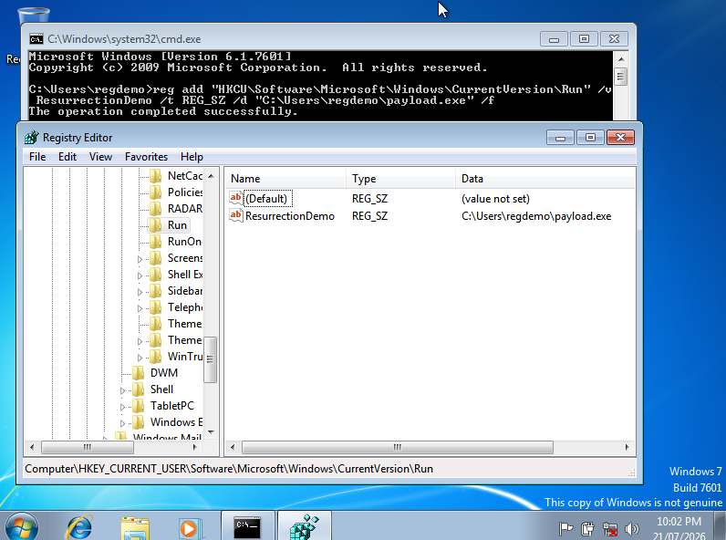

*Figure 4. The persistence key created successfully under the Run key.*


#### Step 2: Force it onto disk

The virtual machine was **restarted**, for all the reasons set out in Section 2.3. Without this, the key would never have reached the hive file and there would have been nothing to recover.

#### Step 3: The murder

Signed back in as `regdemo`, the entire key was deleted:

```
reg delete "HKCU\Software\Microsoft\Windows\CurrentVersion\Run\ResurrectionDemo" /f
```

Opening Regedit afterwards, the Run key looks completely clean. To a responder inspecting the live registry, this persistence never existed.
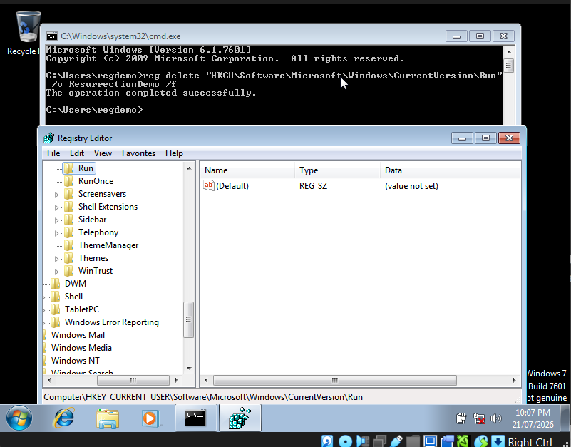
*Figure 5. The Run key after deletion. Nothing to see in Regedit.*


The virtual machine was then shut down cleanly, freezing the freed cell in place.

#### Step 4: Acquire the evidence using FTK Imager

The three files we need all live in the `regdemo` user's profile: the hive itself, `NTUSER.DAT`, and its two transaction logs, `NTUSER.DAT.LOG1` and `NTUSER.DAT.LOG2`. 

With the VM shut down, work through the following.

1. **Add the virtual disk as evidence.** Open FTK Imager and go to `File > Add Evidence Item`. In the Select Source window, choose **Image File**, click Next, then browse to the VM's virtual disk (the `.vmdk` or `.vdi` file inside your VirtualBox VM folder). Select it and click Finish.
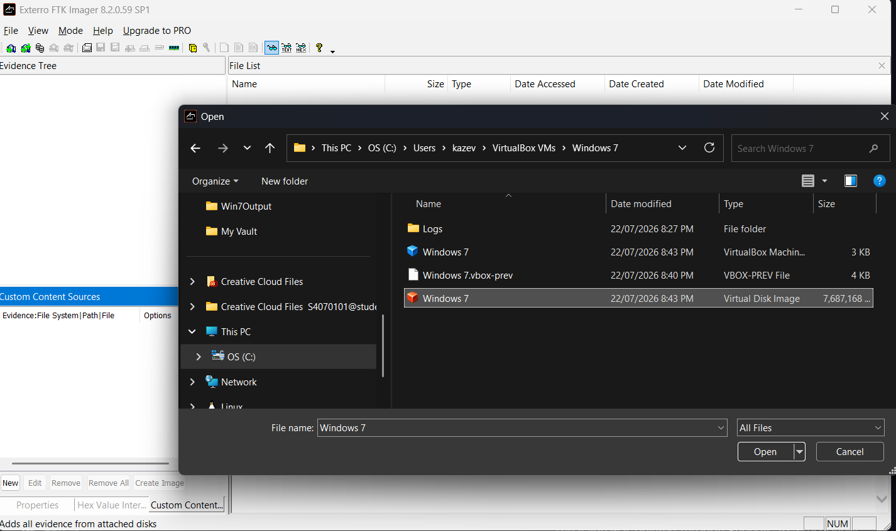

2. **Open the right partition.** In the Evidence Tree on the left, expand the disk you just added. You will usually see more than one partition. Expand the main Windows partition, which is normally the largest NTFS one, until you reach its root, shown as `[root]`.
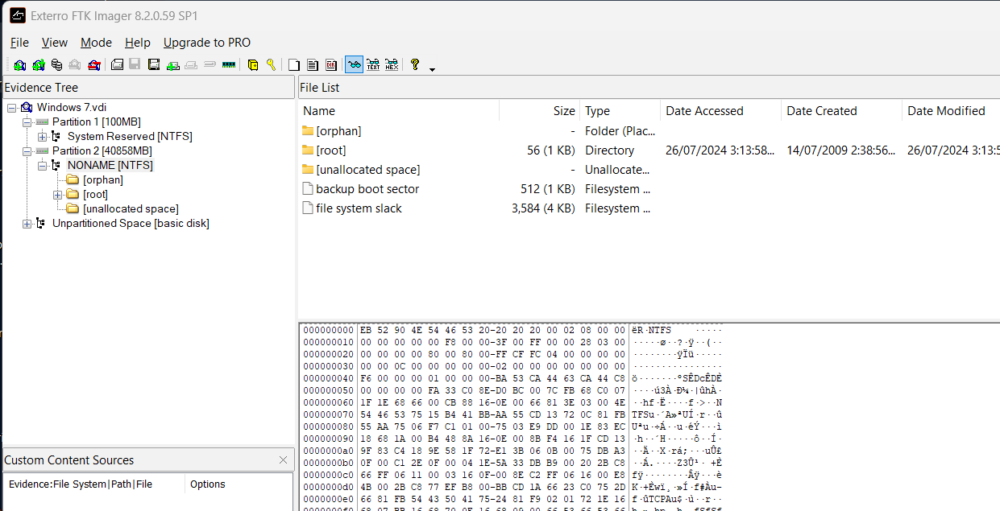

3. **Navigate to the profile.** Drill down through `Users > regdemo`. The file list on the right now shows everything in that profile folder, including the hidden system files that Explorer keeps out of sight.

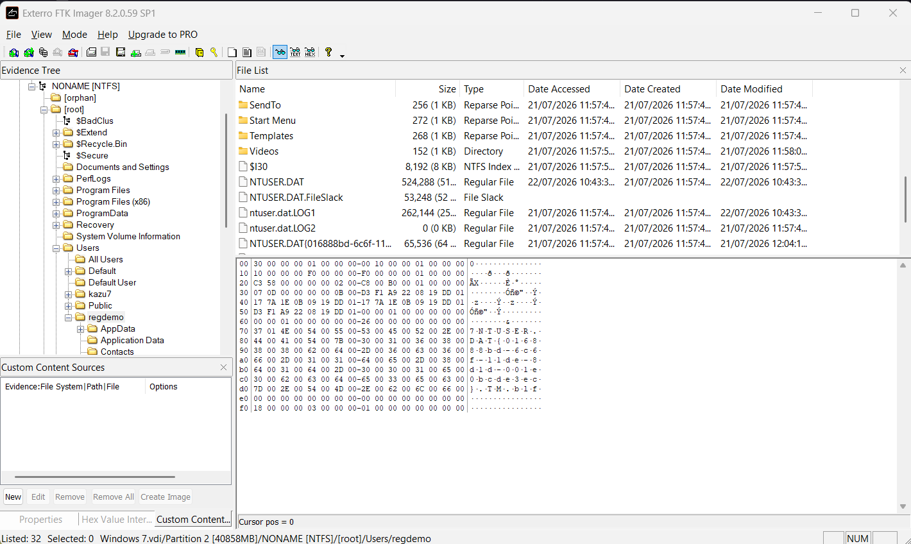

4. **Select all three files together.** In the file list, find `NTUSER.DAT`, `NTUSER.DAT.LOG1`, and `NTUSER.DAT.LOG2`. Click the first, then hold Ctrl and click the other two so all three are highlighted at once, in a single selection.

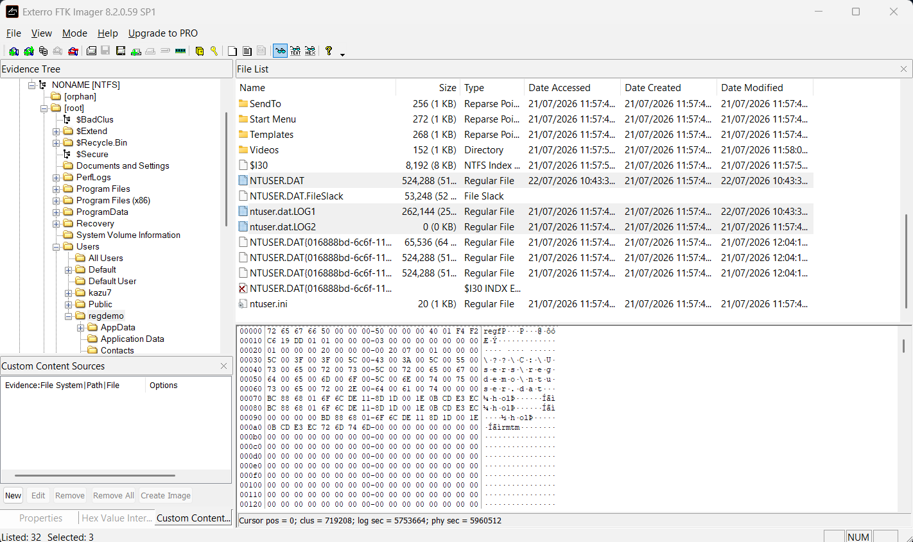

5. **Export them.** Right-click the highlighted files and choose **Export Files**. When the folder picker appears, point it at a brand-new empty folder created just for this capture.

6. **Check the result.** FTK Imager reports how many files it copied and flags any errors. 
   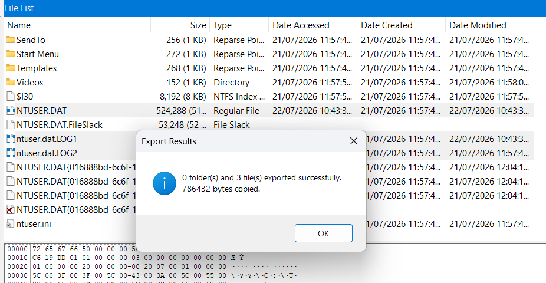

7. **Confirm** all three arrived and that the sizes look right, with `NTUSER.DAT` much larger than the two logs. This exported set is your evidence. 
   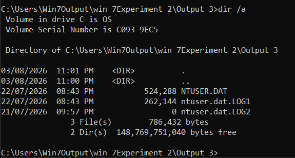 

Two practical rules:

1. **Export all three files in one operation, into a brand-new empty folder.** Mixing files from different captures produces mismatched hive and log sets that will not replay correctly.
2. **Never use `reg save` or `reg export` for this.** Those produce a re-serialised copy of the live registry. Suhanov (2020) tested this and found that an export does not preserve everything: data beyond the last hive bin is not written out, so a small portion of recoverable deleted keys and values is lost even though it still exists in the original hive. Raw acquisition only.

#### Step 5: The resurrection using Registry Explorer

Now the deleted key gets pulled back out of the hive. This is where the three files from Step 4 earn their keep. Registry Explorer reads `NTUSER.DAT`, but it also replays the two `.LOG` files alongside it, which is why we grabbed all three together rather than the hive on its own.

Work through the following.

1. **Load the hive.** Open Registry Explorer and go to `File > Load hive`. Browse to the capture folder from Step 4 and type `NTUSER.DAT`. If Registry Explorer detects that the hive is dirty and that transaction logs are present, it will ask whether you want to replay them. Say **yes**, and point it at the two `.LOG` files in the same folder when prompted. Replaying the logs brings the hive to its true final state before you start looking.
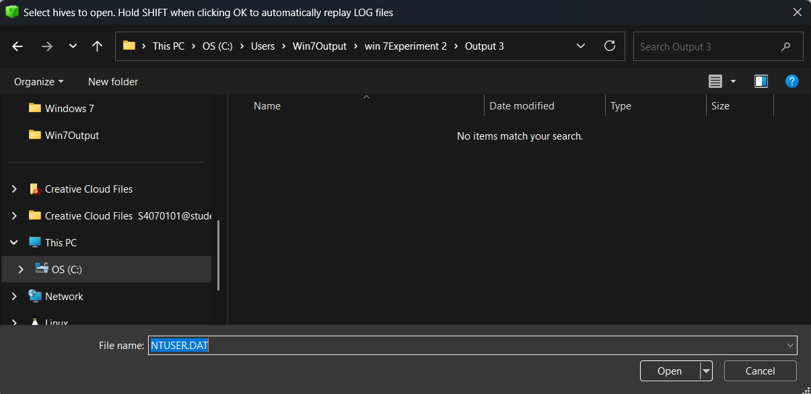

2. **Confirm deleted record recovery is on.** Registry Explorer carves deleted records automatically when it loads a hive, so there is no button to press here. You confirm it worked by looking at the tree on the left. Two special nodes appear near the top, separate from the normal live keys: **Associated deleted records** and **Unassociated deleted records**. If you see those, recovery ran.
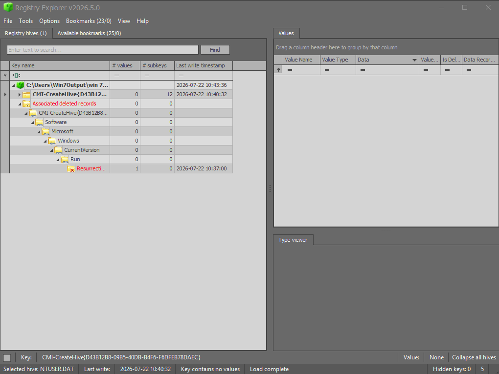

3. **Open the Associated deleted records node.** Expand **Associated deleted records**. This is the bucket that matters, because these are the deleted items that still carry a pointer back to their parent, so Registry Explorer can rebuild where they lived. Expand it one level at a time and follow the path down. You are walking the same route the attacker's command used, in reverse:

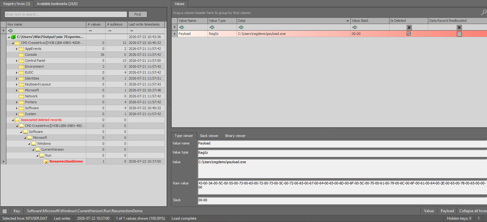 

Selecting the recovered key showed the `Payload` value with its data fully intact: `C:\Users\regdemo\payload.exe`, flagged as deleted, with its last write timestamp preserved.

**This is the result the whole lab was built for.** Not just the data, but the location. The status bar confirms it:
`Key: Software\Microsoft\Windows\CurrentVersion\Run\ResurrectionDemo`

Body and grave, both recovered. Not just _what_ was deleted, but _where_ it lived.

#### An honest detail: partial recovery

Two values were planted (`Payload` and `Config`), but only `Payload` came back. The `Config` value's cell did not show up, possibly because the cell had been reused.

This is worth stating plainly because it is realistic. Cell reuse happens **per cell**, not per key. Recovery is not all-or-nothing, and a recovered artifact may be incomplete. It is a lead to corroborate, not a complete record. Via (2019) makes a related warning: when cells have been reused, tools "will make incorrect deleted value associations and output invalid data," so recovered entries should always be treated as leads rather than conclusions.

---

## 3. Conclusion and next step

### What Part 1 established

- Deleting from the Windows registry does not erase the data. It marks the space as reusable, and the content survives until something overwrites it (Thomassen, 2008; Via, 2019).
- **Rebooting between creating and deleting the artifact is essential.** Without it, the change may live and die entirely in memory and never reach the disk at all, leaving nothing to recover.
- Recovery is a race against cell reuse. Nothing is guaranteed, and acquiring early matters.
- There is a critical difference between recovering **data** and recovering **location**, and only the second one carries real evidential weight (Carvey, 2008).
- Deleting a key rather than a value is what makes an associated, path-preserving recovery possible.
- A deleted persistence key on Windows 7 was successfully recovered with its full registry path intact, using free tools.

### What is coming next

**Part 2: The Modern Windows Problem.** The identical procedure was run on Windows 11, and the results were noticeably different, particularly around how quickly free cells get reused and what happened to the registry backup folder. Part 2 covers that comparison honestly, including the attempts that failed and why.

### Credit

This lab was built and documented as part of my ongoing learning through the **CyLynk** platform. Thanks to Sammy Chuks and CyLynk for providing the structure and direction that turned this pile of miserable daydreaming SOC-analyst-to-be's scattered forensic curiosity into an actual, reproducible investigation.

---

## 4. Reference

**Primary research**

- Via, D. (2019). *Digging Up the Past: Windows Registry Forensics Revisited*. FireEye / Trellix.
  https://www.trellix.com/en-au/blogs/research/digging-up-the-past-windows-registry-forensics-revisited/
- Thomassen, J. (2008). *Forensic Analysis of Unallocated Space in Windows Registry Hive Files*. University of Liverpool.
  https://sentinelchicken.com/research/thomassen_registry_unallocated_space/
- Morgan, T. D. (2008). *Recovering deleted data from the Windows registry*. Digital Investigation, 5, S33-S41.
  https://www.sciencedirect.com/science/article/pii/S1742287608000303

**Registry internals and tooling**

- Suhanov, M. (n.d.-a). *Windows registry file format specification*.
  https://github.com/msuhanov/regf/blob/master/Windows%20registry%20file%20format%20specification.md
- Suhanov, M. (2018). *Tools that recover deleted registry data don't do the same job*. dfir.ru
  https://dfir.ru/2018/11/18/tools-that-recover-deleted-registry-data-dont-do-the-same-job/
- Suhanov, M. (2020). *Exporting registry hives from a live system*. dfir.ru
  https://dfir.ru/2020/10/03/exporting-registry-hives-from-a-live-system/
- Suhanov, M. (n.d.-b). *yarp: yet another registry parser*.
  https://github.com/msuhanov/yarp

**Practitioner guidance**

- Carvey, H. (2008). *Deleted Keys in the Registry*. Windows Incident Response.
  http://windowsir.blogspot.com/2008/07/deleted-keys-in-registry.html
- Carvey, H. (2019). *Registry Transaction Logs, pt II*. Windows Incident Response.
  http://windowsir.blogspot.com/2019/04/registry-transaction-logs-pt-ii.html
- Rathbun, A. *Registry Explorer / RECmd guide*. AboutDFIR.
  https://aboutdfir.com/toolsandartifacts/windows/registry-explorer-recmd/
- Fortuna, A. (2021). *Windows registry Transaction Logs in forensic analysis*.
  https://andreafortuna.org/2021/02/06/windows-registry-transaction-logs-in-forensic-analysis/

**Tools used**

- Zimmerman, E. *Registry Explorer*. https://ericzimmerman.github.io/
- Exterro. *FTK Imager*. https://www.exterro.com/digital-forensics-software/ftk-imager
- Kroll. *KAPE*. https://www.kroll.com/en/services/cyber/incident-response-litigation-support/kroll-artifact-parser-extractor-kape

**Microsoft documentation**

- Microsoft. (n.d.). *RegFlushKey function (registry lazy flush behaviour)*.
  https://learn.microsoft.com/en-us/windows/win32/api/winreg/nf-winreg-regflushkey
- Microsoft. (2019). *The system registry is no longer backed up to the RegBack folder starting in Windows 10 version 1803*.
  https://learn.microsoft.com/en-us/troubleshoot/windows-client/installing-updates-features-roles/system-registry-no-backed-up-regback-folder

**Threat context**

- Mandiant, _M-Trends (2026)_, [https://cloud.google.com/blog/topics/threat-intelligence/m-trends-2026/](https://cloud.google.com/blog/topics/threat-intelligence/m-trends-2026/)
- MITRE ATT&CK. (n.d.-a). *T1547.001: Boot or Logon Autostart Execution: Registry Run Keys / Startup Folder*.
  https://attack.mitre.org/techniques/T1547/001/
- MITRE ATT&CK. (n.d.-b). *T1112: Modify Registry*. https://attack.mitre.org/techniques/T1112/
- MITRE ATT&CK. (n.d.-c). *T1070: Indicator Removal*. https://attack.mitre.org/techniques/T1070/

**Training**

- 13Cubed (Davis, R.). *Investigating Windows Endpoints*. https://www.13cubed.com/


